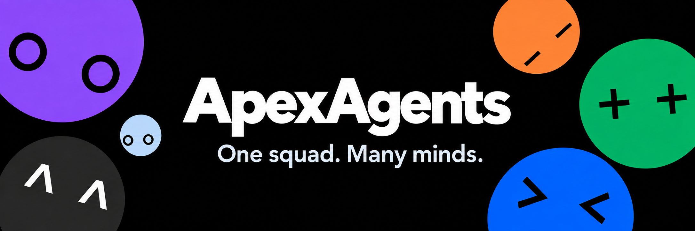
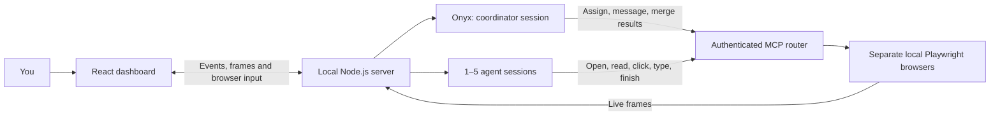

# ApexAgents



**One task, a visible team of browser agents, and one combined answer.**

By [Vijay Anand](https://github.com/vijayanand1505) and [D Amarnath](https://github.com/amarnath3003). Vijay Anand is the project owner and founder. [Contributions and development history](#people-and-development-history) explain the documented roles and source provenance.

ApexAgents is a personal, local-first project for researching, comparing and testing websites. **Onyx** coordinates up to five agents—**Plum, Lime, Tango, Blu and Sky**—each with its own browser. You can watch their work, send follow-ups, take over a browser, and read the combined result with sources.

The public website showcases the project. Real agent tasks run on the owner's computer and use the configured OpenAI API account. Public signup, cloud execution for independent users, subscriptions and a spending cap are not implemented. There is no commitment to paid cloud hosting; client demonstrations can use a temporary private connection.

[Live links](#live-links-and-hosting) · [How it works](#how-it-works) · [People and history](#people-and-development-history) · [Quick start](#quick-start) · [Run controls](#squad-sizing-speed-and-recovery) · [Sharing](#connect-the-hosted-dashboard-to-your-laptop) · [Checks](#commands-and-verification) · [Limitations](#data-costs-and-limitations)

<a href="docs/video/apexagents-intro.mp4"></a>

[Watch the 52-second film with sound](docs/video/apexagents-intro.mp4) · [Storyboard and production notes](docs/video/storyboard.md). The film and landing animation illustrate the workflow; they are not a recording of the viewer's live task.

## Live links and hosting

| Page | Direct link | Needs a laptop backend? |
| --- | --- | --- |
| Landing page, cast and launch film | [apexagents.vercel.app](https://apexagents.vercel.app/) | No |
| Live dashboard frontend | [apexagents.vercel.app/app](https://apexagents.vercel.app/app) | Yes, plus a private sharing connection |
| BuggyMart with all 10 planted bugs | [Open BuggyMart](https://apexagents.vercel.app/buggymart/) | No, when exploring the shop manually |
| BuggyMart with those bugs disabled | [Open the fixed reference](https://apexagents.vercel.app/buggymart/fixed/) | No, when exploring the shop manually |

All four pages belong to **one Vercel project**, `apexagents`, in **Vijay's Team** (`vijay-s-team4`), under account **`vijayanand15`**. [Open the Vercel project](https://vercel.com/vijay-s-team4/apexagents). In its **Deployments**, open the production deployment and inspect **Resources → Static Assets** for the `buggymart/` and `buggymart/fixed/` files. Sign in to the owning workspace to manage them.

[`vercel.json`](vercel.json) builds `web/dist/`; [`web/export-buggymart.mjs`](web/export-buggymart.mjs) adds both static shop versions. They are folders within the same deployment, not separate Vercel projects. [`.vercelignore`](.vercelignore) excludes environment files, backend scripts and private runtime data from deployment.

Vercel serves the frontend assets. Browser processes, the API key, run history and profiles remain on the laptop. Website/film/shop browsing does not make paid agent requests; starting a real agent task does.

## How it works



1. **Describe a goal.** For example, compare phones under ₹15,000, research a trip, or inspect BuggyMart. Choose Auto/manual squad size and a speed preset.
2. **The server prepares the team.** It resolves the size, opens separate browser profiles and connects the MCP tools through an authenticated tunnel. Agent sessions can be warmed while Onyx plans.
3. **Onyx delegates.** Its coordinator session uses web search and gives agents specific goals and allowed sites. Onyx coordinates; the worker agents operate the browsers.
4. **Agents perform real browser actions.** The Agents API calls this project's MCP tools. Agents read numbered page elements, navigate, click, type and scroll in local Playwright browsers. This is separate from the scripted landing animation.
5. **Progress returns to the dashboard.** Browser frames and events travel over WebSocket. Reports, messages and failures update the team card. You can guide Onyx through chat or take over a browser to handle a human check.
6. **Reports become a final result.** Onyx combines the findings and sources. Completed reports collapse, and the final answer gets the main reading area. **View browsers** returns to the workspace; **Read results** returns to the answer.
7. **History stays local.** Run events and results are saved on disk. Ended or interrupted chats reopen read-only; a live process can resume eligible unfinished work.

MCP means **Model Context Protocol**: the connection through which the agents call this project's browser and coordination tools. The default local dashboard/API is on port **8787**, and its separate MCP service is on **8788**. Hosted dashboard sharing adds a different bridge on **8790**.

Use only sites and test environments you are authorized to interact with. Results depend on the task, model, site availability and human checks; parallel browsers do not guarantee a fixed completion time or factual accuracy.

## People and development history

The project was developed for the **DevDay Exchange Community Hackathon: Kochi**, held **10–11 October 2026** at **JAIN University, Kochi, rooms 2008 and 2009**. The recorded schedule was check-in at 6:00 PM IST, kickoff at 6:30 PM on 10 October, and wrap-up by 10:00 AM on 11 October. See [event rules](RULES.md) and the [event listing](https://luma.com/z10nz8gp).

| Contributor | Documented role and contribution | Main areas |
| --- | --- | --- |
| **[Vijay Anand](https://github.com/vijayanand1505)** — owner and founder | Product direction and the engine/server/dashboard workstream, including task orchestration and integration. Directed the later ApexAgents rename, local browser/startup fixes, final-results presentation, film timing corrections, Vercel hosting in his account, and Auto sizing/recovery/speed presets. Implementation assistance is recorded in `AI_USAGE.md`. | [Engine/server](scripts/lib/), [React dashboard](web/src/), [run settings](web/shared/run-settings.ts), hosting configuration and project documentation |
| **[D Amarnath](https://github.com/amarnath3003)** — contributor | Character studio, animated cast and selectors, sound design, banner and original launch film. His repository supplied the studio components used in `web/`; the retained history also records the event landing page, animated delegation/BuggyMart publishing and a later root-startup fix. | [Characters](web/src/characters/), [selectors](web/src/launch/), [effects](web/src/effects/), [film/assets](docs/video/), and the original studio history |

These credits summarize the submission record, retained Git history and AI usage log; they do not imply that each contributor manually authored every line. Codex and Claude Code assisted with planning, implementation, debugging, documentation and verification. Their actual recorded tasks and human-review status are in [AI_USAGE.md](AI_USAGE.md).

| When | What happened | Evidence |
| --- | --- | --- |
| **10 October 2026** | Planning and specification; initial API/browser experiments and the character studio workstream. | [Planning transcript](docs/chat-history/2026-10-10-planning-chat.md), [specification](master.md), Git history and AI usage log |
| **Night of 10–11 October** | Browser orchestration, classic dashboard, React integration, characters, sound and film were developed across the workstreams. | [Development changelog](CHANGELOG.md), [historical handoff](HANDOFF.md), [AI usage](AI_USAGE.md) |
| **11 October** | The merged project/studio export was incorporated, followed by the landing page and public BuggyMart variants. | Integration commit `89f3c14`; original event demo checkpoint `feaa0f3919336e3dfd65cece5cd189b5a7ecd161` in [submission records](SUBMISSION.md) |
| **20 October** | Continued after the event: ApexAgents branding, local compatibility fixes, final-results focus, Vijay's Vercel deployment, synchronized film and new run controls. | Changelog; run-controls checkpoint `4e9761e` and deployment record `04fe353` |

The character studio was originally developed in [Amarnath's SquadLings repository](https://github.com/amarnath3003/SquadLings); component provenance references include `45f625f` and the later film work. Its imported history and original source URLs remain credited. The current project name is ApexAgents; older records may use SquadLink or SquadLings.

The public project repository is **[vijayanand1505/ApexAgents](https://github.com/vijayanand1505/ApexAgents)**. This checkout's `origin` points there and `main` tracks `origin/main`. The original SquadLings repository is retained as `upstream` for provenance. First publication retained all 43 existing commits and contributor metadata while redacting one historical credential; 14 commit IDs changed. [Migration notes and the commit map](docs/repository-migration.md) explain older checkpoint IDs. The original event checkpoint remains distinct from later implementation and does not imply organizer submission or acceptance; [SUBMISSION.md](SUBMISSION.md) retains that record.

## Quick start

<a id="-quick-start"></a>

Use a terminal in the **repository root**, not the archived `dashboard/` directory. These commands assume a POSIX shell such as Bash or Zsh.

```sh
git clone https://github.com/vijayanand1505/ApexAgents.git
cd ApexAgents
```

Prerequisites:

- **Node.js 24 recommended**, selected by [`.nvmrc`](.nvmrc). The root package declares Node 22.18+; Node 18 is unsupported.
- npm and the dependencies from the root and `web/` lockfiles.
- Playwright Chromium, or a compatible installed Chrome browser.
- For real runs: `cloudflared` on `PATH`, internet access, and an OpenAI API key with access to the project's Agents API/models. Landing/shop previews and the scripted mock do not require that key.

```sh
# If nvm is installed, select the version in .nvmrc.
nvm install                   # first time only
nvm use

# Install the locked dependencies in both packages.
npm ci
npm --prefix web ci

# One-time browser download.
npx playwright install chromium
```

Install `cloudflared` using [Cloudflare's installation instructions](https://developers.cloudflare.com/cloudflare-one/connections/connect-networks/downloads/) (`brew install cloudflared` on supported macOS installations). If your OS is unsupported by Homebrew, use an appropriate official binary on your `PATH`.

For a fresh checkout, copy [`.env.example`](.env.example) to `.env.local`, then replace the placeholder **in your editor** with your own key. Keep existing configuration if that file already exists.

```sh
# Fresh checkout only: do not overwrite an existing .env.local.
cp -n .env.example .env.local

# After saving your key in the editor:
npm run dev
```

Open **http://127.0.0.1:8787**. `npm run dev` aliases `npm run ui`: it builds the React frontend and starts the local server, MCP router and tools tunnel. An optional `npm run prewarm` in another terminal keeps the MCP tunnel ready between launches.

For the first task, choose **Quick** and try a small research request, or run BuggyMart separately and ask Onyx to inspect it. You can send follow-ups while agents work. **Stop** pauses work and keeps the chat open; **End chat** closes that run's browsers and saves the record. Use **New chat** for another task.

### Installed Chrome and common startup problems

On machines where bundled Chromium cannot be installed, add `PLAYWRIGHT_CHANNEL=chrome` to `.env.local` and keep Google Chrome installed. This selects Chrome for the agents' separate profiles; it does not use your personal Chrome profile. Leave the variable unset to use bundled Chromium. `chromium` and `msedge` are also accepted explicit channels; compatibility depends on the installed browser and OS.

| Symptom | What to check |
| --- | --- |
| `node:util` has no `styleText` export | Run `nvm use` in that terminal and check `node --version` before restarting. |
| Playwright says the executable does not exist | Install Chromium, or configure the installed Chrome channel above, then restart. |
| Missing API key or HTTP 401 | Set a valid `OPENAI_API_KEY` in an ignored root environment file and restart. `VERCEL_OIDC_TOKEN` is not the app's OpenAI key. |
| Tools offline or a Cloudflare 429 | Confirm `cloudflared` is installed, check tunnel logs, and avoid repeatedly opening new tunnels; use prewarm when appropriate. |
| Updated code is not visible | Restart the backend after server changes. Fix any frontend build error: the startup script can fall back to the last build or classic dashboard. |

### Local frontend and landing-page development

Keep the backend running for real dashboard work. In another terminal:

```sh
nvm use
npm run web
```

Open **http://127.0.0.1:5173** for the dashboard with hot reload; Vite proxies `/api` and `/ws` to the backend on 8787.

To preview the **landing page and public shops without a backend**, use:

```sh
nvm use
VITE_REMOTE_BACKEND=true npm run web
```

Open **http://127.0.0.1:5173** for the landing page. `/app` shows the hosted connection flow in this mode. Both BuggyMart paths also work. Normal local builds use the local API; the `VITE_REMOTE_BACKEND=true` flag selects the hosted-connection mode.

### Scripted demo without paid API calls

After dependency/browser installation, build the normal local frontend and run the mock server:

```sh
nvm use
VITE_REMOTE_BACKEND=false npm run web:build
node scripts/dev-mock-ui.ts --port 8796 --mcp-port 8795
```

Open **http://127.0.0.1:8796**, select two agents for the scripted scenario, and submit a task. The mock Onyx and two bots follow the same prepared local scenario regardless of the prompt. It exercises the real dashboard, MCP router and browsers, but sends nothing to OpenAI and requires no Cloudflare tunnel. It is a labelled development/demo mode, not open-ended AI research. Set `PLAYWRIGHT_CHANNEL=chrome` in the shell if needed. When Lime reaches the simulated human-check page, take over its browser, click **I’m a person**, and hand control back to let the scripted run finish.

## Squad sizing, speed and recovery

New React dashboard settings default to **Auto + Balanced**. Auto uses a local English/URL heuristic: a focused summary suggests one agent, shopping two, comparisons three, and audits up to five. The popover explains the suggestion; the backend resolves the actual count before opening browsers. Use **Choose myself** or +/− to override it. Explicit requests such as “use five agents” also override the preset's Auto cap. Existing saved manual settings are preserved.

| Preset | Onyx / agent effort | Actions per agent | Run time limit | Auto team cap |
| --- | --- | --- | --- | --- |
| Quick | Low / Low | 20 | 8 minutes | 2 |
| Balanced | Medium / Medium | 30 | 20 minutes | 4 |
| Thorough | High / High | 60 | 30 minutes | 5 |

Presets control work budgets, not guaranteed response times or dollar limits. They keep a manually chosen team size. Editing effort, actions or timeout marks the settings **Custom**. Settings persist in browser storage; classic/CLI callers keep their existing defaults.

The progress line shows waiting reasons and the age of the last activity. **Resume** becomes available for failed sessions, busy sessions quiet for 90 seconds, unanswered idle runs with no working agents for 15 seconds, and user-paused work. Silence can be normal reasoning, so recovery is explicit rather than an automatic restart. Browser takeover or a pending site decision blocks recovery until resolved.

Resume replaces affected unfinished sessions, retains completed reports/sources and browser pages, and preserves action consumption and the original deadline. It confirms the old session was deleted before creating its replacement, waits for queued browser actions and prevents duplicate recovery jobs. If Onyx restarts, it receives the task, user messages and completed findings. Existing session/API retries also remain. Recovery errors are shown; restarting a stopped server does not restore its old live browser sessions.

When the final answer arrives, report panels collapse and the full answer opens at its heading. Reports can be expanded again. Tables, source links and Copy remain available; new plans restore the browser workspace. Brief completion motion respects reduced-motion settings. These completion/recovery controls belong to the React dashboard; classic mode keeps its earlier layout.

## Connect the hosted dashboard to your laptop

The form at [the hosted dashboard](https://apexagents.vercel.app/app) connects to an already-running local backend. It is not a public account-registration form.

Keep `npm run dev` running, then in a second terminal run:

```sh
nvm use
npm run share
```

The sharing command creates an authenticated bridge on **8790**, opens a separate HTTPS Cloudflare tunnel, and opens a private connection link. That link is also saved locally to ignored, owner-only `spikes/out/share-ui/connect.txt`. Opening it in another browser fills the connection details automatically.

| Form field | Meaning |
| --- | --- |
| **Laptop address** | The HTTPS bridge address generated by `npm run share`, not the dashboard's localhost address or the MCP tunnel. |
| **Access key** | The generated bridge key, not an OpenAI key or Vercel password. It is encoded in the private connection link. |

Treat that private link as a password: anyone with it can control this squad and submit tasks charged to your API account. Share only with trusted demo viewers. Keep the laptop awake and both terminals running. The browser removes the key from the address bar and stores the connection in the current tab's session storage. `Ctrl+C` in the sharing terminal revokes that bridge connection; a new sharing session creates a new key and address.

Advanced options: `npm run share -- --target http://127.0.0.1:8796` shares the scripted mock backend; `--frontend https://your-site.example` allows a different exact frontend origin. This sharing tunnel is separate from the agents' MCP tunnel on 8788.

## BuggyMart QA playground

BuggyMart is a deliberately small shop with six products, search/category/sort, variants, cart quantities, a coupon and simulated checkout. It gives the agents reproducible browser bugs to find. The fixed route is an existing bugs-off reference; the agent does not patch the deployed shop by visiting it.

| Version | Hosted | Local Vite preview |
| --- | --- | --- |
| All 10 planted bugs enabled | https://apexagents.vercel.app/buggymart/ | http://127.0.0.1:5173/buggymart/ |
| Those bugs disabled | https://apexagents.vercel.app/buggymart/fixed/ | http://127.0.0.1:5173/buggymart/fixed/ |

The Vite command in [local development](#local-frontend-and-landing-page-development) serves both paths without a separate shop process. Alternatively, run the standalone shop:

```sh
npm run buggymart                    # http://127.0.0.1:3001, bugs enabled
npm run buggymart -- --bugs none      # same port, bugs disabled; stop the first process first
```

Use **Reset demo** before repeating a run. Each version keeps separate cart state in the current tab; independently opened tabs/browsers have their own sessions. Checkout uses fictional details and no real payment. Ask agents for reproduction steps, expected/actual behavior and severity. Keep the maintainer answer key out of their prompts.

Full controls, expected failures and test options: [BuggyMart README](targets/buggymart/README.md). The answer key is not deployed as a public asset. Running the shop manually is independent of OpenAI; asking real agents to test it uses the normal paid API setup.

## Configuration

Backend root environment precedence is: **already-exported variables → `.env.local` → `.env`**. Files do not replace values already set in the process. Both real environment files are ignored by Git; [`.env.example`](.env.example) contains placeholders only.

| Variable | Scope and behavior |
| --- | --- |
| `OPENAI_API_KEY` | Required for real agent runs; stays on the backend computer. |
| `OPENAI_BASE_URL` | Optional API endpoint override; defaults to `https://api.openai.com/v1`. |
| `MODEL_MASTER` | Default Onyx model for the dashboard/CLI: `gpt-6.1-sol`. |
| `PLAYWRIGHT_CHANNEL` | Optional installed browser channel; unset uses bundled Chromium. |
| `APEXAGENTS_API` | Vite's backend proxy target; default `http://127.0.0.1:8787`. |
| `VITE_PORT` | Optional Vite development port; default `5173`. |
| `VITE_REMOTE_BACKEND` | Set to `true` when building/previewing the landing page and hosted connection mode. |

The dashboard defaults worker agents to `gpt-6-luna`; change models through its advanced options. The CLI has `--master-model`/`--bot-model` flags. `MODEL_BOT` in the example is used by the separate computer-use spike; it does not change the dashboard's default. `MODEL_VISION` and `MODEL_DECISIONS` remain legacy experiment/specification entries and are not read by the current dashboard server.

## Commands and verification

Run commands from the repository root with the supported Node version selected. There is no configured lint command; the project uses typechecks and focused tests.

| Command | Purpose |
| --- | --- |
| `npm run dev` / `npm run ui` | Build and serve the React dashboard/backend on 8787. |
| `npm run ui -- --no-open` | Start without opening a browser tab. |
| `npm run ui -- --classic` | Serve the original `ui/` dashboard. |
| `npm run ui -- --help` | See ports, tunnel reuse, warm-up and verbosity options. |
| `npm run web` | Vite frontend development on 5173. |
| `npm run web:build` | Frontend typecheck/build and export both static BuggyMart variants. |
| `npm run squad -- "your task"` | Terminal version of the real squad. |
| `npm run prewarm` | Keep an MCP tunnel ready. |
| `npm run share` | Temporarily connect the hosted frontend to a local backend. |
| `npm run buggymart` | Standalone QA shop on 3001. |
| `npm run typecheck` | Server, target and test TypeScript checks. |
| `npm --prefix web run check` | Frontend TypeScript check. |
| `npm test` | Offline unit/bridge, mock API, browser/MCP, squad, dashboard, results and run-controls checks. |
| `npm run test:unit` | Unit and authenticated-sharing bridge tests. |
| `npm run test:results` | Build and test final-results focus, report folding, replay and reduced motion. |
| `npm run test:controls` | Build and test sizing/presets, persistence, recovery and responsive controls with scripted agents and real browsers. |
| `npm run test:buggymart` | Separate browser regression for the planted bugs and working baseline. |
| `npm run bench` | Local browser performance benchmark. |

For installed Chrome, run `PLAYWRIGHT_CHANNEL=chrome npm test`; test runners do not automatically load root `.env.local`. The standalone BuggyMart test uses `PLAYWRIGHT_CHROMIUM_EXECUTABLE_PATH` instead; see its README. Offline mocks are not evidence of live model quality or current website compatibility.

The changelog records the 20 October checks, including 27 unit/bridge tests, 35 run-controls checks and 22 hosted browser checks. Hosted smoke checks used mocked backend traffic, not paid live agent runs. Older latency/cost examples and TestTown results in `master.md` are historical observations from specific tasks, not performance or billing guarantees.

## Publishing and media maintenance

The current deployment is managed in Vijay's Vercel workspace. From an authorized checkout, verify identity before publishing:

```sh
npx vercel whoami
npx vercel project inspect apexagents --scope vijay-s-team4
npx vercel deploy --prod --scope vijay-s-team4
```

For a fresh authorized checkout, first link it with `npx vercel link --yes --project apexagents --scope vijay-s-team4`. The expected account is `vijayanand15`, and project owner is Vijay's Team. Vercel installs/builds only the frontend with `VITE_REMOTE_BACKEND=true`; no OpenAI key is needed on Vercel. Backend changes need a separate local restart.

Deployment currently uses the CLI. Automatic GitHub deployment is not connected; the GitHub repository is now published, but connecting it to Vercel is a separate optional setup step. The original `squadlings.vercel.app` project was retained separately, and only the ApexAgents domain assignment was moved to Vijay's project. Exact deployment checkpoints are in [CHANGELOG.md](CHANGELOG.md) and [SUBMISSION.md](SUBMISSION.md).

The launch film's current export synchronizes plus presses, agent counts and arrivals, retains its soundtrack, and uses a poster and responsive player. `FFMPEG_PATH=/path/to/ffmpeg npm run film:render` re-exports the original local `dashboard/dist` studio archive using installed Chrome. That archive and FFmpeg are not provided in a fresh clone; distributed MP4 playback needs neither. See the [storyboard](docs/video/storyboard.md) and [asset credits](docs/landing-assets.md).

## Data, costs and limitations

- **One active run per backend.** Multiple connected viewers share that squad; the current bridge does not create independent user accounts or private customer workspaces.
- **Local storage.** Logs/results are written under ignored `spikes/out/`; persistent agent profiles live in `spikes/profile/`. Clean-profile runs use temporary profiles. Deleting these local records removes the corresponding history/state.
- **Costs.** Real tasks use the backend owner's API account. The displayed amount estimates model-token costs and is not a complete invoice; tools or hosted environments may add charges. Presets limit actions/time rather than dollars, and there is no implemented spending cap.
- **Access boundaries.** The local dashboard checks Host/Origin; the MCP service uses per-run authenticated routes. Optional sharing adds a separate key-protected dashboard bridge. Neither connection is a public multi-user hosting solution.
- **Site access.** Browser navigation is gated by allowed sites; agents' requests for new sites go to Onyx. A dedicated approval flow for purchases or other consequential actions remains unimplemented.
- **Human checks.** Agents do not solve CAPTCHAs. They can report a blocker and try other normal pages/sources; you may take over and hand control back.
- **Sensitive data.** Direct takeover input is excluded from event logs, but visited-page content, screenshots, findings and browser cookies can still be sensitive. Keep profiles, logs, keys and private connection links out of commits and public demos.
- **Recovery scope.** Resume operates inside the live backend process. A server restart does not resurrect old browser sessions; interrupted chats remain readable from saved records.
- **Availability.** Websites can block automation, APIs can reject requests, and tunnels can fail or be rate-limited. Auto sizing recognizes English task patterns/URLs and can be overridden.
- **Future work.** Public accounts/cloud workers, hard spending controls, task templates, dedicated action approvals and voice are future options, not shipped features or required expenses for this personal showcase.

## Repository map and sources

```text
ApexAgents/
├── scripts/
│   ├── ui.ts, squad.ts          local dashboard and terminal entry points
│   ├── dev-mock-ui.ts           scripted demo, no OpenAI calls
│   ├── share-ui.ts, prewarm.ts  sharing bridge and tools tunnel
│   ├── render-launch-film.ts   archive-based media recorder
│   ├── lib/                    orchestration, sessions, MCP, browsers and site gate
│   └── tests/                  offline tests and mock Agents API
├── web/
│   ├── src/landing/            public landing page and film viewer
│   ├── src/home/, src/shell/   composer, settings and live progress
│   ├── src/live/, src/chat/, src/wall/  state, conversation and browser tiles
│   ├── shared/                 cast, preset rules and health contract
│   ├── public/                 media, fonts and public assets
│   └── export-buggymart.mjs    build-time export of both shop versions
├── targets/buggymart/          QA shop source, answer key and separate tests
├── ui/                        original plain-JS dashboard
├── docs/                      assets, film, planning transcript and references
├── master.md                  historical specification, experiments and run notes
├── HANDOFF.md                 historical integration notes, not current setup authority
├── CHANGELOG.md, AI_USAGE.md   implementation and development-assistance records
├── SUBMISSION.md, RULES.md     event record and organizer rules
└── vercel.json                frontend publishing and route configuration
```

Technology sources: [OpenAI API](https://developers.openai.com/), [Model Context Protocol SDK](https://github.com/modelcontextprotocol/typescript-sdk), [Playwright](https://playwright.dev/), [cloudflared](https://developers.cloudflare.com/cloudflare-one/connections/connect-networks/), [Node.js](https://nodejs.org/), [TypeScript](https://www.typescriptlang.org/), [React](https://react.dev/), [Vite](https://vite.dev/), [Motion](https://motion.dev/) and [Zustand](https://zustand.docs.pmnd.rs/). No external datasets are required.

Characters, studio animation, sound, banner and original film retain the [original studio source credit](https://github.com/amarnath3003/SquadLings). Landing fonts are locally hosted **Bricolage Grotesque** and **DM Sans**, with their SIL Open Font Licenses included; [asset credits](docs/landing-assets.md) record sources. The palette/art references follow the DevDay material. OpenAI names/artwork belong to their respective owners; no endorsement is implied.

For contribution workflow, documentation and commit conventions, read [AGENTS.md](AGENTS.md). Historical records describe their own checkpoints; the setup and limitations above describe the current project.
